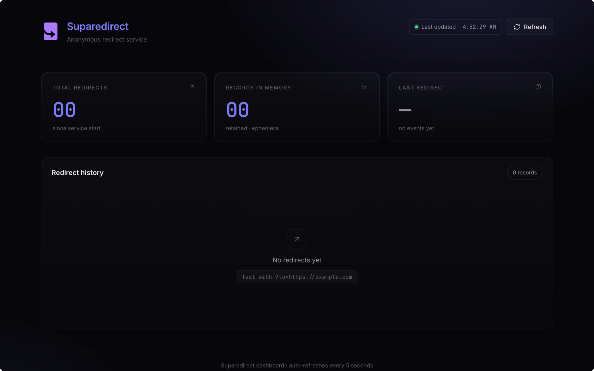

<p align="center" class="logo-section">

</br>


<p align="center">
🔄 Self-hosted anonymous URL redirect service (dereferer) for Node.js and Express that strips the Referer header, with a Docker image and a React stats dashboard<br>
<br/>
<br/>

</p>
<p align="center">
<a align="center" href="#">Documentation</a>
  </p>
</p>

<p align="center">

</p>

<p align="center">



</p>

- **Referer stripping**: each redirect page is sent with `Referrer-Policy: no-referrer` and a `<meta name="referrer" content="no-referrer">` tag, so the target site does not see where the visitor came from.
- **One-parameter API**: `GET /?to=<url>` redirects to any URL. Bare domains get `https://` added.
- **Stats dashboard**: a React dashboard on port 5173 reads `GET /api/stats` every 5 seconds and shows the total redirect count and the latest 500 redirects with URL, time and user agent. Stats live in memory and reset on restart.
- **Docker image**: `halitsever/suparedirect:latest` on Docker Hub, rebuilt on every push to `main`.

<p align="center" >

</p>

Running via docker:

```bash
# expose api port only
docker run -p 3000:3000  halitsever/suparedirect:latest

# expose dashboard & api ports
docker run -p 3000:3000 -p 5173:5173  halitsever/suparedirect:latest

```

For development:

```bash
npm i
```

```bash
npm run start
```

Usage:

```bash
curl http://localhost:3000/?to=https://halit.org
```

you can use `to` parameter for redirecting to any website

<p align="center" href="https://github.com/halitsever/suparedirect/issues">

</p>

<p align="center">
Found a bug or have an idea? Open an <a href="https://github.com/halitsever/suparedirect/issues">issue</a>.<br/>
Read the <a href=".github/CONTRIBUTING.md">contributing guide</a> before sending a pull request.
</p>

<p align="center">

</p>

<p align="center">

</p>

<p align="center">
  MIT License - Halit Sever
</p>
